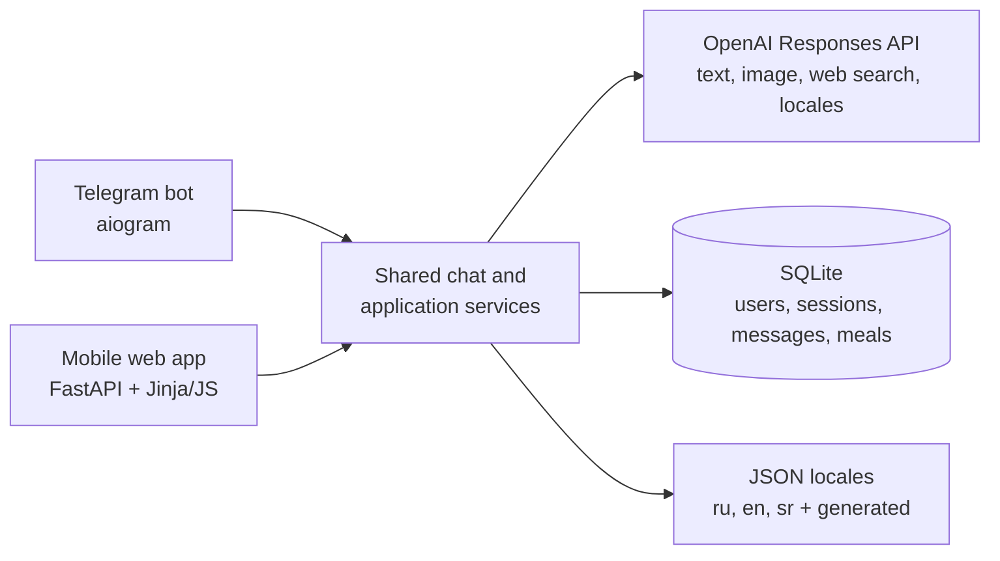

# ChatW8Less

**A Telegram bot + mobile-friendly web app for food tracking, calorie and macro estimates, and everyday nutrition questions.**

I started ChatW8Less for a practical reason: I wanted to lose weight without turning every meal into a spreadsheet, and I wanted to make food tracking easier for my mom. Telegram made logging a meal as simple as sending “70 g chicken, 20 g rice”; the web app came later for the moments when a regular browser is more convenient.

This personal project began as a private calorie-tracking bot/site for my mom and later became public. It demonstrates building and maintaining a useful AI-assisted tool; it is not a claim of commercial clients, adoption at scale, or measured business impact. The public repository excludes personal configuration and usage data.

## Quick start: offline demo (no API key)

Use a separate checkout and Python 3.14.10 (see `.python-version`). From the repository root:

```bash
python -m venv .venv
# macOS/Linux:
source .venv/bin/activate
# Windows PowerShell instead:
# .\.venv\Scripts\Activate.ps1
python -m pip install --require-hashes -r requirements-lock.txt
python -m tools.demo
```

Dependency installation needs internet access. The demo itself uses no paid API,
Telegram connection, browser server, personal photos, or existing database. Do not
copy `.env` for this demo. It prints a clearly labeled fictional meal and finishes
with `PASS: offline demo; temporary data removed.` A nonzero exit means a check failed.

The scenario signs in as a fictional user, sends `Demo porridge 100 g` through the
real web API in process, parses a fixed mock OpenAI response, checks that the draft
has not been saved, explicitly saves it, and reads it back. The fixture's 120 kcal
and macros are invented for software testing, not nutritional advice or model output.
Only the SDK response is substituted; routing, authentication, request construction,
application parsing, formatting, chat history and SQLite persistence run normally.

`tools/offline.py` disables dotenv loading, replaces inherited application settings,
uses temporary storage, disables Telegram polling, and blocks HTTP transports and
non-loopback socket connections. Loopback is allowed for Windows event-loop internals;
the demo does not start a listening web server. Temporary data is removed on normal
exit. This is a development harness, not a production demo mode or security sandbox.
Run it as a fresh process, not inside a running application's interpreter.

## At a glance

- **Interfaces:** Telegram bot and responsive web app with shared history
- **OpenAI flows:** structured text parsing, image analysis, web-assisted Q&A, locale generation
- **Backend:** Python 3.14, FastAPI, aiogram 3
- **Storage:** SQLite for users, sessions, messages, settings, and saved meals
- **Delivery:** Docker / Docker Compose and Railway-friendly configuration
- **Product details:** passphrase sessions, model modes, daily limits, assistant naming
- **Localization:** Russian, English, Serbian Latin, plus generated locales
- **Quality:** pytest smoke tests for database, web API, Telegram, localization, and settings flows

## Architecture



## What it does

- Estimates calories and macros from a text meal description.
- Recognizes food from photos and estimates approximate weights.
- Calculates nutrition per 100 g for recipes and mixed dishes.
- Answers product, recipe, grocery, and nutrition questions with online search.
- Saves meals and shows daily, weekly, and all-time nutrition statistics.
- Lets each user focus the interface on calories, protein, carbohydrates, or any combination, with optional daily targets.
- Shares message history and user settings between Telegram and the website.
- Supports user-level nutrition focuses, language, model mode, daily limit, and assistant name.

The assistant keeps a small, dedicated conversation context for natural follow-ups, while calorie-parsing requests remain isolated so earlier meals do not leak into a new calculation.

## Project structure

```text
bot/
  app_services.py      # application-level nutrition, online, locale, import flows
  chat_service.py      # shared chat/history flows for web and Telegram
  db.py                # SQLite schema, migrations, users, sessions, meals
  handlers.py          # Telegram command/message handlers
  i18n.py              # locale loading, fallback, generated locales
  openai_client.py     # OpenAI API wrappers
  telegram_app.py      # bot setup and command registration
locales/               # built-in ru, en, sr translations
static/                # browser JavaScript, CSS, favicon
templates/             # Jinja web UI
tests/test_smoke.py
web_app.py             # FastAPI app and web API
manage_users.py        # user-management CLI
```

## Local setup

Copy the example configuration and install the development dependencies:

```bash
cp .env.example .env
python -m pip install --require-hashes -r requirements-lock.txt
```

For real AI/Telegram operation (separate from the offline demo), configure:

```env
OPENAI_API_KEY=...
TELEGRAM_API_TOKEN=...
ALLOWED_USER_IDS=123456789,987654321
SITE_URL=https://your-app.example.com
```

Start the shared web + bot backend:

```bash
uvicorn web_app:app --host 127.0.0.1 --port 8000 --reload
```

Then open `http://127.0.0.1:8000/`. If `TELEGRAM_API_TOKEN` is configured and `RUN_TELEGRAM_IN_WEB=true`, Telegram polling starts in the same process. For Telegram-only mode, run `python main.py`.

## User management

Create a Telegram-linked user:

```bash
python manage_users.py create --name "Family User" --telegram-id 123456789 --phrase "secret passphrase" --language ru
```

Create a web-only user:

```bash
python manage_users.py create --name "Guest" --phrase "another secret passphrase" --language en
```

Other commands:

```bash
python manage_users.py list
python manage_users.py set-phrase --user-id 123456789 --phrase "new secret passphrase"
```

Only passphrase hashes are stored.

## Docker and deployment

Build and run locally:

```bash
docker compose up --build
```

The compose file mounts `./storage` and `./logs`; neither belongs in Git. For Railway or another container host, use a persistent volume and point `DATABASE_PATH` inside it.

Recommended production settings:

```env
DATABASE_PATH=/app/storage/chatw8less.sqlite3
WEB_COOKIE_SECURE=true
RUN_TELEGRAM_IN_WEB=true
```

To keep an old host online as a migration landing page, set only the target
address and disable Telegram polling:

```env
MIGRATION_TARGET_URL=https://new-site.example.com
RUN_TELEGRAM_IN_WEB=false
```

Migration mode does not initialize the database or start Telegram polling.
The home page shows a move notice and button, while other application routes
redirect to the new site using `303 See Other`.

## Tests

```bash
python -m pytest -q
python tests/check_model_requests.py
python -m tools.demo
```

The smoke suite covers database migrations, web login and API flows, shared history, meal saving, settings, Telegram behavior, localization, and assistant context.

Pytest initializes the same isolated runtime before importing the application.
All database migration tests use temporary databases. AI responses are mocked;
unexpected HTTP calls fail instead of reaching an API. The demo regression check
also launches the documented command with conflicting inherited settings and
verifies that the supplied database path is untouched. The standalone request
contract script captures eight synthetic SDK requests without calling OpenAI.

`.github/workflows/tests.yml` runs these three commands on Python 3.14.10 for pull
requests or manual dispatch, with read-only repository permissions and no secrets.
It contains no deployment steps. Hosting integrations outside GitHub Actions are
separate and must be checked before publishing a branch. No lint or type-check
configuration currently exists; these commands are functional/contract checks.

Direct dependencies are pinned in `requirements.txt` and `requirements-dev.txt`.
`requirements-lock.txt` additionally locks transitive development/runtime dependencies
and distribution hashes for the reproducible offline-check environment. Regenerate it
with `uv pip compile requirements-dev.txt --python-version 3.14 --universal --generate-hashes --output-file requirements-lock.txt`.
Dependency installation still contacts the package index; tests do not require secrets.

## Design decisions and limits

- Web and Telegram share application services and SQLite state, keeping interface
  behavior consistent. The offline demo exercises the web path; it does not verify
  live Telegram delivery, browser JavaScript, deployment, or concurrent production use.
- Structured AI function results are parsed and formatted before a meal is saved.
  Draft and explicit-save behavior can therefore be tested independently of model
  availability. The mock stays in development tooling and is never imported by the
  production entry points.
- Text and photo nutrition values remain estimates. Photo portion sizes and model
  answers can be wrong; this app is not a medical or dietary assessment tool.
- No model accuracy, cost, or latency evaluation was performed for this demo. Passing
  deterministic fixtures demonstrates software behavior, not AI quality. Real-model
  evaluation needs a consented, representative dataset and a separate documented
  method before reporting results.

## Local verification of this change

On Windows with Python 3.14.10 and the locked dependencies:

- `python -m pytest -q`: 30 passed (including the installed SDK through an in-memory HTTP transport).
- `python tests/check_model_requests.py`: eight captured requests passed; zero API calls.
- `python -m tools.demo`: passed; temporary demo data removed.
- `uv pip check --python .venv314/Scripts/python.exe --no-cache`: 44 packages compatible.
- `python -m compileall -q bot web_app.py tools tests`: passed.
- The official `python:3.14.10-slim` image manifest exists; image build/run was not performed.

The baseline dependencies also passed the existing 27 smoke tests plus the first two
new demo/isolation tests on Python 3.13.7. The final run emitted one warning about an
invalid certificate in the host Windows certificate store; no certificate settings
were changed. Restricted Windows execution initially stalled on asyncio's internal
loopback socket pair; the successful runs allowed that local mechanism while retaining
the harness's external HTTP blocks.

GitHub-hosted CI, Linux/container runtime, browser UI, live OpenAI/Telegram and any
production deployment were not run. No model quality/cost/latency measurements were
made. These checks support review of a local change, not a production rollout claim.

## Security

- Never commit `.env`, SQLite databases, logs, or `storage/`.
- Keep `ALLOWED_USER_IDS` restricted for private/family use.
- Use secure cookies behind HTTPS and persistent storage in production.
- Rotate Telegram and OpenAI keys if they are ever committed or shared.

See [SECURITY.md](SECURITY.md) for reporting guidance.

## Author

[Dmitrii Gorlov](https://github.com/dmitriygorlov) · [LinkedIn](https://www.linkedin.com/in/ds-marketer)

## License

MIT

